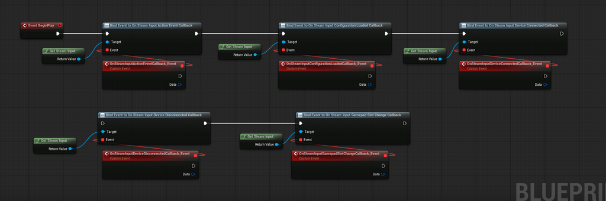

## Input

Added five Steam Input callbacks.

- `OnSteamInputConfigurationLoadedCallback`
- `OnSteamInputDeviceDisconnectedCallback`
- `OnSteamInputGamepadSlotChangeCallback`
- `OnSteamInputDeviceConnectedCallback`
- `OnSteamInputActionEventCallback`

