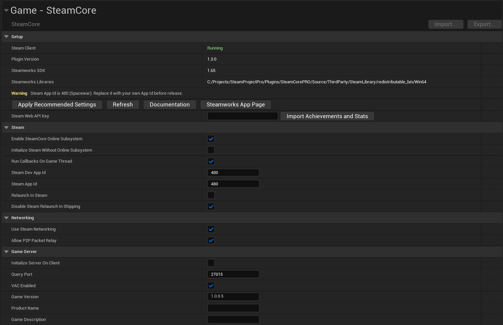
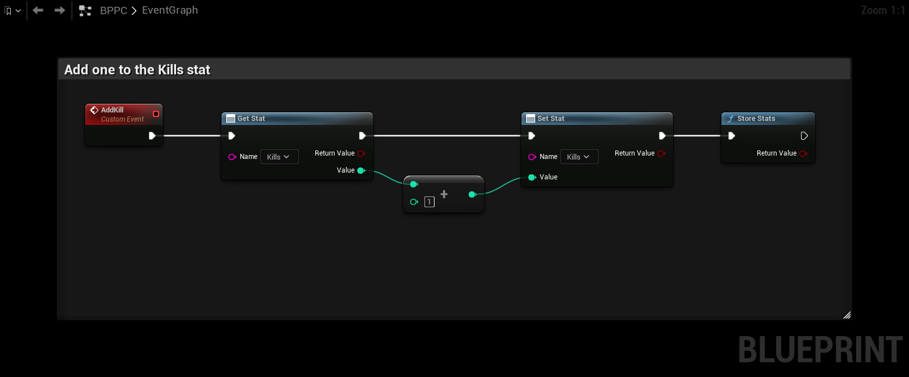
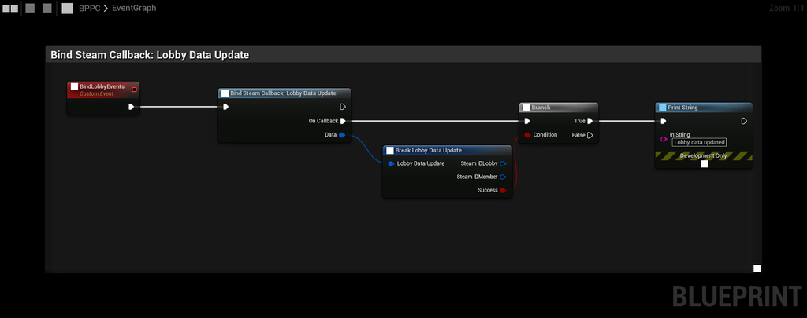
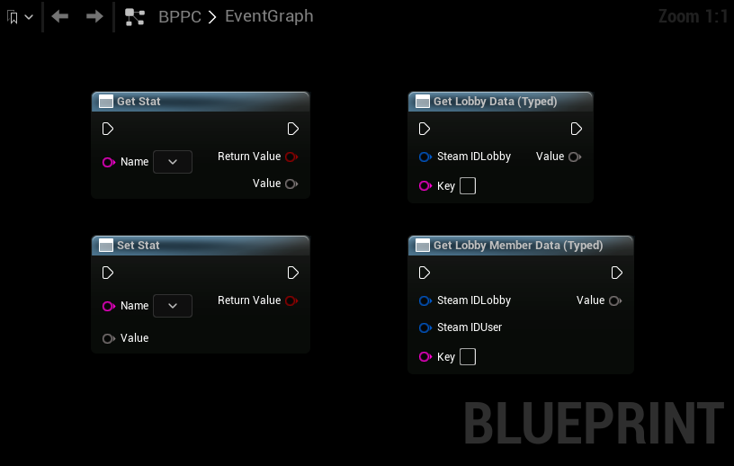

## Steam without the online subsystem

- The `SteamCoreShared` module now initializes Steam, so the SteamCore online subsystem is optional for clients.
- Use **Initialize Steam Without Online Subsystem** (`bInitSteamWithoutOnlineSubsystem`) to enable this mode.
- Dedicated servers still use the online subsystem to log on to Steam.
- Pass `-nosteamcore` to skip Steam initialization.
- The Steam overlay also works in this mode.

## Project settings

- SteamCore settings are back under **Project Settings > Game > SteamCore**.
- A new **Setup** section shows the client status, plugin and Steamworks SDK versions, and the path the Steamworks libraries load from. It also links to the docs and the app’s Steamworks page.
- The setup checks have **Fix** buttons for Steam initialization and for setting `DefaultPlatformService` to `SteamCore`.
- **Apply Recommended Settings** preserves existing App IDs when writing the recommended configuration.
- The level editor toolbar now has a **SteamCore** button.
- **Import Achievements** and **Import Stats** download Steamworks definitions into `DT_SteamAchievements` and `DT_SteamStats` under `/Game/SteamCore`.
- In non-shipping builds, run `showdebug steamcore` to display Steam status on screen.

## Blueprint nodes

- Added **Get Stat**, **Set Stat**, and **Get User Stat**.
- Added typed nodes for getting and setting lobby and lobby member data, as well as **Make Session Setting** and **Get Session Setting**.
- Added **Bind Steam Callback** nodes.
- After an import, the name pins on User Stats nodes offer the imported names in a dropdown.
- **Game Server Item** now exposes **Had Successful Response**. Server browsers can use it to hide or flag servers that did not answer the details query.

