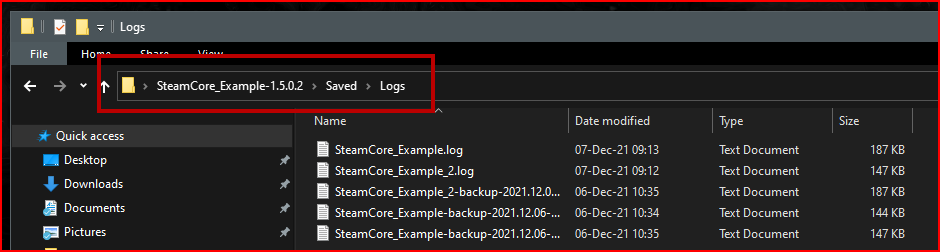

# Additional Logging
If you want more logging output in your SteamCore project, you can add the following lines to your **DefaultEngine.ini** configuration file

## DefaultEngine.ini
```ini
[Core.Log]
Online=Verbose
OnlineSession=Verbose
OnlineGame=Verbose
LogSteamCorePro=Verbose
LogSteamCoreSockets=Verbose
LogSteamCoreShared=Verbose
LogOnlineSubsystemSteamCore=Verbose
```

### Networking and Voice
When troubleshooting connection or voice chat issues, these engine categories are also useful:
```ini
[Core.Log]
LogNet=Verbose
LogSockets=Verbose
LogOnlineVoice=Verbose
```

:::tip
You can also enable a log category for a single run with a launch parameter, e.g. `-LogCmds="LogSteamCoreSockets Verbose"`.
:::

## Finding Logs
Logs are always generated in your projects Saved directory, see the screenshot below.

