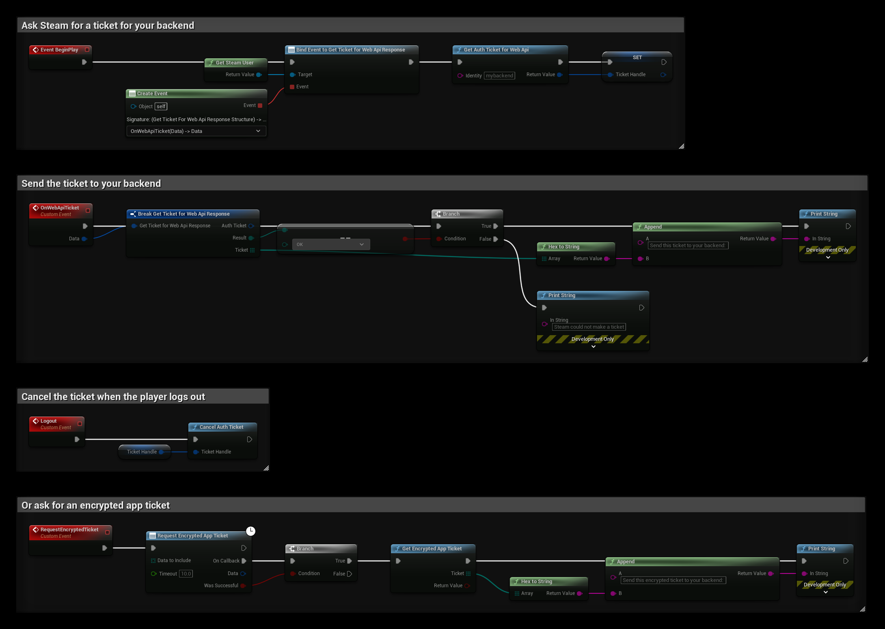

# Logging In to Your Own Backend

If your game has its own server or web service, for example for accounts, matchmaking or a shop, the server needs to know which Steam player is calling it. The game cannot simply send its Steam ID, since anyone can send any Steam ID. Instead, the game asks Steam for a ticket, sends it to your server, and the server asks Steam who the ticket belongs to.

:::info Dedicated servers
This page is about your own backend. To check players who join an Unreal dedicated server, see [Authenticating Steam Users](./authenticating_steam_users.md).
:::

## Prerequisites
- Your own Steam App ID, see [Using Your Own App ID](../getting_started/using-own-app-id.md).
- A **Publisher Web API Key** for your server, from **Users & Permissions → Manage Groups** on the [Steamworks partner site](https://partner.steamgames.com/). Keep it on the server, never in the game.

## Web API Tickets
### In the Game
1. Use **Get Steam User** and bind **Get Ticket for Web Api Response**.
2. Call **Get Auth Ticket for Web Api** with an **Identity**, a name for your server such as `mybackend`. Keep the **Return Value**, the ticket handle.
3. When **Get Ticket for Web Api Response** fires with **Result** **OK**, turn **Ticket** into text with **Hex to String** and send it to your server, for example in a login request.
4. When the player logs out, call **Cancel Auth Ticket** with the ticket handle.

### On the Server
Your server calls Steam's [AuthenticateUserTicket](https://partner.steamgames.com/doc/webapi/ISteamUserAuth#AuthenticateUserTicket) Web API with your Publisher Web API Key, your App ID, the ticket and the same identity. Steam answers with the player's **steamid**, and also **ownersteamid**, which differs from it when the game is borrowed through Family Sharing, and whether the player is VAC or publisher banned.

The server now knows the player's Steam ID and can give the game its own session token.

:::tip SteamCore::Web
With the [SteamCore::Web](https://www.fab.com/listings/7e0f0b69-0b35-4652-9cff-ef32a342e433) plugin, a server built with Unreal can call **Authenticate User Ticket** from Blueprints.
:::

## Encrypted App Tickets
An encrypted app ticket can be checked by your server without calling Steam, and can carry a few bytes of your own data. The server decrypts it with your **Encrypted App Ticket Key** from the Steamworks partner site and the `sdkencryptedappticket` library in the Steamworks SDK.

1. Call **Request Encrypted App Ticket**. **Data to Include** is optional data that is put in the ticket.
2. If **Was Successful** is true, call **Get Encrypted App Ticket** and send the **Ticket** to your server.

Only one request can be pending at a time, and Steam allows one request per minute.

## Example
`TicketHandle` is a **Steam Ticket Handle** variable:
- **BeginPlay** binds **Get Ticket for Web Api Response** and asks for a Web API ticket.
- **OnWebApiTicket** turns the ticket into text if Steam made it. Send that text to your backend instead of printing it.
- **Logout** cancels the ticket.
- **RequestEncryptedTicket** asks for an encrypted app ticket and turns it into text.

