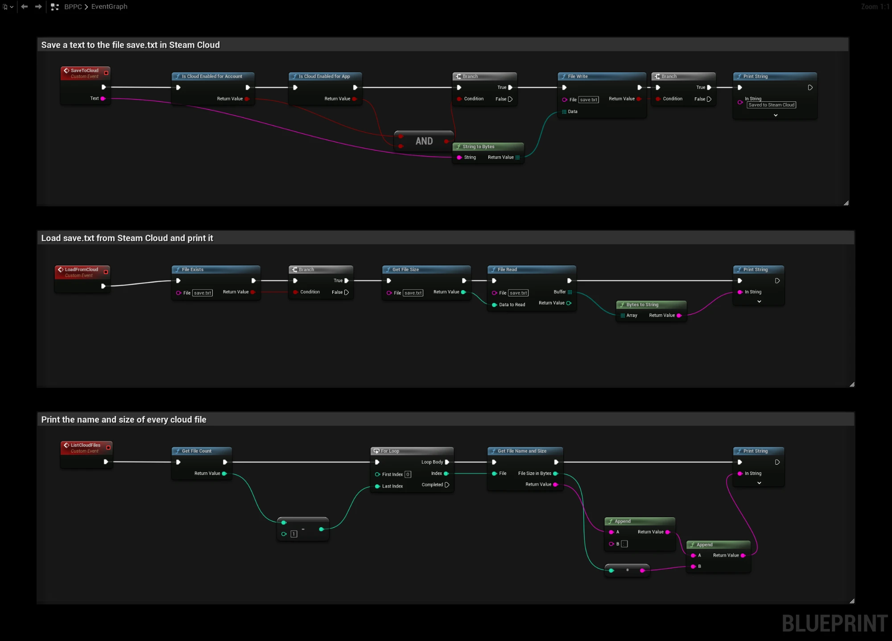

# Cloud Saves

:::info Video Tutorial is available
[Video Tutorial](../videos/cloud-save-games.mdx)
:::

Steam Cloud keeps save files in sync between a player's computers. There are two ways to use it:

- **Steam Auto-Cloud** syncs files from a folder on disk. It needs no Blueprint code and works with Unreal's regular **Save Game to Slot** and **Load Game from Slot** nodes.
- **Steam Remote Storage** lets you read and write cloud files directly from Blueprints with the **SteamCore|RemoteStorage** nodes.

Use one of them per file. Do not let Auto-Cloud and Remote Storage manage the same files.

## Step 1: Enable Steam Cloud
1. Open your app on the [Steamworks partner site](https://partner.steamgames.com/apps/) and go to **Application → Steam Cloud**.
2. Set **Byte quota per user** and **Number of files allowed per user**.
3. Save and **publish** the changes.

## Option A: Steam Auto-Cloud
Packaged Unreal Engine games on Windows store save games in:

```
%LOCALAPPDATA%\<ProjectName>\Saved\SaveGames
```

Add a **Root Path** under **Auto-Cloud Configuration** in Steamworks:

| Setting | Value |
| --- | --- |
| Root | `WinAppDataLocal` |
| Subdirectory | `<ProjectName>/Saved/SaveGames` |
| Pattern | `*.sav` |
| OS | Windows |

Replace `<ProjectName>` with the name of your project. If you ship on Linux or macOS, add **Root Overrides** for their save game folders as well.

:::note
Auto-Cloud only syncs packaged builds started through Steam. When you run the game from the editor or a Standalone Game, save games are stored in your project's `Saved/SaveGames` folder instead, which is not synced.
:::

## Option B: Steam Remote Storage
The Remote Storage nodes work with byte arrays.

### Checking Availability
Before using the cloud, check **Is Cloud Enabled for Account** and **Is Cloud Enabled for App**. The player can turn Steam Cloud off for a game in the Steam client.

### Writing a File
1. Convert your data to bytes, for example with **String to Bytes** or, for an existing file, **Read File to Bytes**.
2. Call **File Write** with a file name and the bytes. It returns `true` on success.

### Reading a File
1. Call **File Exists** to check that the file is in the cloud.
2. Call **Get File Size** to get the size in bytes.
3. Call **File Read** with the file name and the size as **Data to Read**. **Buffer** contains the file data.
4. Convert the bytes back, for example with **Bytes to String**.

### Other Useful Nodes
| Node | Description |
| --- | --- |
| **File Delete** | Deletes the file from the cloud and locally. |
| **File Forget** | Removes the file from the cloud but keeps the local copy. |
| **Get File Count** / **Get File Name and Size** | List all cloud files for the user. |
| **Get Quota** | Total and available bytes for the user. |
| **Get User Data Folder** (on **Get Steam User**) | The local Steam userdata folder for the player and game, for files you manage yourself. |

### Example
- **SaveToCloud** checks that Steam Cloud is enabled for the account and the app, converts **Text** to bytes and writes it to `save.txt`.
- **LoadFromCloud** checks that `save.txt` exists, reads it and prints the text.
- **ListCloudFiles** prints the name and size of every cloud file for the user.



## Testing
- Steam must be running and the game must use your own App ID.
- In the Steam client, open the game's **Properties → General** and make sure Steam Cloud is enabled.
- You can see the files stored for your account at [store.steampowered.com/account/remotestorage](https://store.steampowered.com/account/remotestorage).
