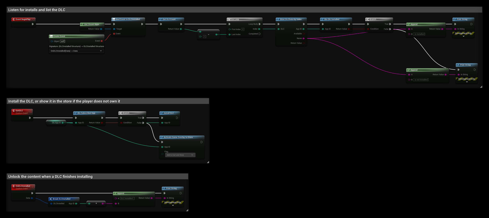

# DLC and Ownership

SteamCore PRO can list your game's DLC, check which DLC the player owns and has installed, install optional DLC and open a DLC's store page.

## Prerequisites
- Your own Steam App ID, see [Using Your Own App ID](../getting_started/using-own-app-id.md).
- Each DLC created on the [Steamworks partner site](https://partner.steamgames.com/apps/), with its own App ID.

## Listing the DLC
**Get DLC Count** returns how many DLC your game has. Call **BGet DLC Data by Index** with an index from 0 to the count minus one to get each DLC's:

| Output | Description |
| --- | --- |
| **App ID** | The DLC's App ID. |
| **Available** | True if the DLC has a store page the player can see. |
| **Name** | The DLC's name. |

## Checking Ownership
| Node | Returns true when |
| --- | --- |
| **BIs Dlc Installed** | The player owns the DLC **and** it is installed. Use this before you load DLC content. |
| **BIs Subscribed App** | The player owns the app, installed or not. Works for DLC App IDs and for other games, for example a demo. |

Ownership can change while the game runs, for example when the player buys a DLC in the overlay. Check again when **DLC Installed** fires instead of only at start.

## Installing and Removing DLC
DLC that is set to optional in Steamworks is not downloaded with the game. **Install DLC** asks Steam to download a DLC the player owns, and **Uninstall DLC** removes it. **Get Dlc Download Progress** returns the bytes downloaded so far.

When a DLC finishes installing, **DLC Installed** fires on **Get Steam Apps** with the DLC's **App ID**. Your game then has to load the new content itself, for example by mounting its pak file.

## Selling DLC in the Overlay
If the player does not own the DLC, open its store page with **Activate Game Overlay to Store**. The **Flag** can add the DLC to the player's cart (**Add to Cart**) or add it and show the cart (**Add to Cart and Show**). See [Steam Overlay](./steam_overlay.md).

## Example
`DlcAppID` is an **Integer** variable with your DLC's App ID:
- **BeginPlay** binds **DLC Installed**, then loops over all DLC and prints whether each one is installed.
- **GetDLC** installs the DLC if the player owns it, and opens its store page with the DLC in the cart if not.
- **OnDLCInstalled** prints the App ID of a DLC that finished installing. Unlock or load its content here.

## Beta Branches and Launch Parameters
Other nodes on **Get Steam Apps** that are useful with DLC and updates:
- **Get Current Beta Name** returns the name of the beta branch the player runs, or false on the default branch.
- **Get Launch Query Param** and **Get Launch Command Line** read parameters from a `steam://run` link. **New Url Launch Parameters Delegate** fires when the game is started again with new ones.
