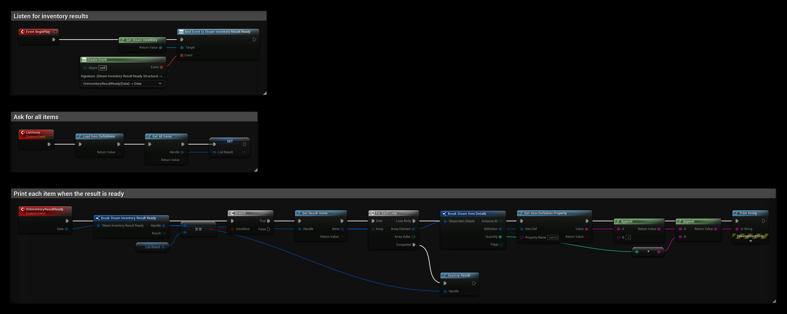
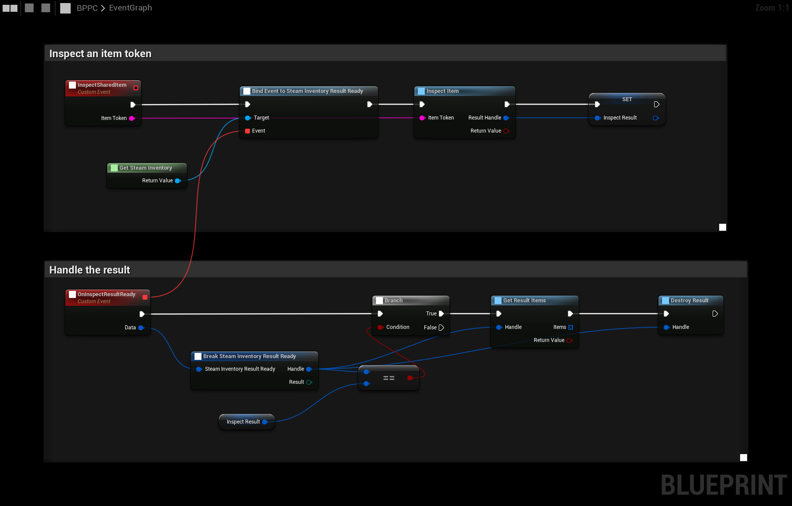

# Steam Inventory

The Steam Inventory Service stores items for each player on Steam, for example cosmetics, crates or crafting materials. This guide uses the **SteamCore|Inventory** nodes.

## Prerequisites
- Your own Steam App ID, see [Using Your Own App ID](../getting_started/using-own-app-id.md).
- Steam is running and the game is launched as a **Standalone Game** or a packaged build.

## Step 1: Define Your Items
1. On the [Steamworks partner site](https://partner.steamgames.com/apps/), go to **Community → Inventory Service** and enable it.
2. Upload your item definitions (a JSON file). Each item has a numeric **itemdefid** and properties such as `name`, `description` and `icon_url`. See Valve's [item schema documentation](https://partner.steamgames.com/doc/features/inventory/schema).
3. **Publish** the changes.

## How Results Work
Most inventory nodes do not return items directly. They return a **result handle**, and Steam fires an event when the result is ready:

1. Call a node such as **Get All Items**. It returns a **Steam Inventory Result**.
2. Use **Get Steam Inventory** and bind **Steam Inventory Result Ready**. When it fires, compare **Handle** with the handle you got using the **==** node, and check **Result**.
3. Call **Get Result Items** with the handle. Each item has an **Instance ID**, a **Definition** (the itemdefid) and a **Quantity**.
4. Call **Destroy Result** with the handle when you are done.

## Listing the Player's Items
Call **Get All Items** and handle the result as described above. **Steam Inventory Full Update** also fires with the complete inventory.

To show names and icons, call **Load Item Definitions** once, then **Get Item Definition Property** with the item's **Definition** and a property name such as `name` or `icon_url`. **Steam Inventory Definition Update** fires when the definitions are loaded or change.

### Example
`ListResult` is a variable of type **Steam Inventory Result**:
- **BeginPlay** binds **Steam Inventory Result Ready**.
- **ListItems** loads the item definitions, calls **Get All Items** and saves the handle in `ListResult`.
- **OnInventoryResultReady** checks that the handle is `ListResult`, prints the `name` and quantity of each item, and destroys the result.

## Granting Items
| Node | Use it for |
| --- | --- |
| **Add Promo Item** / **Add Promo Items** | Giving a promo item, for example a reward for owning another game. The item must be a promo item in your definitions. |
| **Grant Promo Items** | Granting all promo items the player is eligible for. |
| **Trigger Item Drop** | Playtime drops. The definition must be a `playtimegenerator`. |
| **Generate Items** | Testing only. It only works for accounts with access to the app in Steamworks. |

## Using and Combining Items
- **Consume Item** removes a quantity of an item, for example when a consumable is used.
- **Exchange Items** turns items into another item using an exchange recipe from your item definitions, for example for crafting.
- **Transfer Item Quantity** splits or stacks items.
- **Start Update Properties**, **Set Property String/Bool/Int/Float** and **Submit Update Properties** change dynamic properties on an item.

All of these return a result handle that you handle as described in [How Results Work](#how-results-work).

## Verifying Items on a Server
The client's inventory can be modified by cheaters. If items matter for gameplay, verify them on your server:

1. On the client, call **Serialize Result** with the result handle and send the bytes to the server.
2. On the server, call **Deserialize Result** with the bytes.
3. When the result is ready, call **Check Result Steam ID** with the player's Steam ID. Only trust the items if it returns `true`.

## Inspecting Items
**Inspect Item** takes an item token and returns the item it refers to, for example when another player shares an item to be inspected. Handle the result as described in [How Results Work](#how-results-work). Requires SteamCore PRO 1.1.12 or newer.

### Example
The example below binds **Steam Inventory Result Ready**, calls **Inspect Item** and saves the handle. When the result is ready, it checks that the handle matches, reads the items with **Get Result Items** and destroys the result.

`InspectResult` is a variable of type **Steam Inventory Result**. Use the **Items** output of **Get Result Items** to show the item.

## Selling Items
Items can be sold with Steam's in-game purchase flow:
- **Request Prices** loads the prices in the player's currency. Then use **Get Items With Prices** or **Get Item Price**.
- **Start Purchase** opens the Steam purchase dialog for a list of item definitions.

Before you show trading or Community Market features, call **Get Market Eligibility** on **Get Steam User**. **Data → bAllowed** is false if the player can't use the Market, and **Not Allowed Reason Flags** and **Allowed At Time** say why and until when.

For purchases handled by your own backend, see [Microtransactions](../microtransactions/introduction.md).
