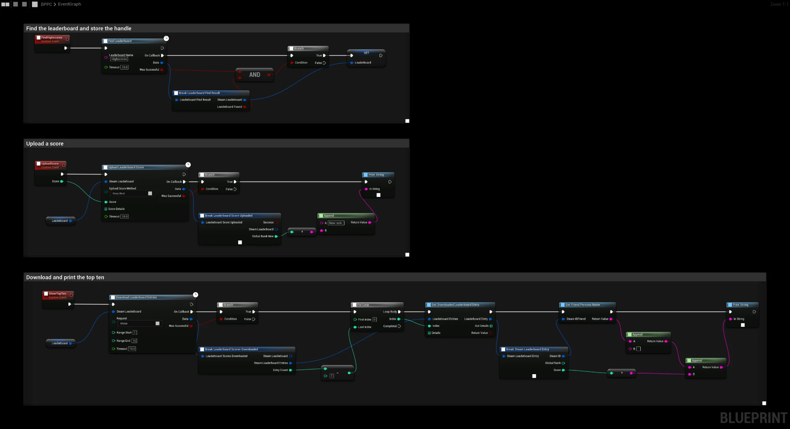

# Leaderboards

:::info Video Tutorial is available
[Video Tutorial](../videos/leaderboards.mdx)
:::

This guide shows how to find a leaderboard, upload a score and list entries with the **SteamCore|UserStats|Async** nodes.

## Prerequisites
- Your own Steam App ID. Leaderboards are configured per app.
- Steam is running and the game is launched as a **Standalone Game** or a packaged build, see [Testing Steam Functionality](../getting_started/testing_steam_functionality.md).

## Step 1: Create the Leaderboard
Create the leaderboard on the [Steamworks partner site](https://partner.steamgames.com/apps/) under **Stats & Achievements → Leaderboards** and publish the changes. Choose the sort method (ascending or descending) and display type (numeric, seconds or milliseconds) there.

You can also create a leaderboard from the game with **Find or Create Leaderboard**, but creating it in Steamworks gives you full control over its settings.

## Step 2: Find the Leaderboard
Every leaderboard node needs a leaderboard handle.

1. Call **Find Leaderboard** with the leaderboard name.
2. On completion, check **bWasSuccessful** and **Data → bLeaderboardFound**.
3. Store **Data → SteamLeaderboard** in a variable. You can reuse it for the rest of the session.

## Uploading a Score
Call **Upload Leaderboard Score** with:

| Input | Description |
| --- | --- |
| **Steam Leaderboard** | The handle from **Find Leaderboard**. |
| **Upload Score Method** | **Keep Best** only replaces the player's score if the new one is better. **Force Update** always replaces it. |
| **Score** | The score to upload. |
| **Score Details** | Optional extra integers stored with the entry, for example a lap time per lap. |

The result contains **bSuccess**, **bScoreChanged**, **GlobalRankNew** and **GlobalRankPrevious**.

## Listing Entries
1. Call **Download Leaderboard Entries** with the leaderboard handle, a **Request** type and a range:

   | Request | Range |
   | --- | --- |
   | **Global** | Ranks, starting at 1. For example `1` to `10` returns the top ten. |
   | **Global Around User** | Relative to the local player. For example `-4` to `5` returns the four entries above, the player and the five below. |
   | **Friends** | The range is ignored; all friends with an entry are returned. |

2. On completion, loop from `0` to **Data → EntryCount** − 1.
3. For each index, call **Get Downloaded Leaderboard Entry** with **Data → SteamLeaderboardEntries**. The entry contains **SteamID**, **GlobalRank** and **Score**.

To show player names, pass **SteamID** to **Get Friend Persona Name**. For avatars, see [Friend Avatars](../multiplayer/friends/friends_list_avatars.md).

To fetch entries for specific players, use **Download Leaderboard Entries for Users** with a list of Steam IDs.

## Other Useful Nodes
| Node | Description |
| --- | --- |
| **Get Leaderboard Entry Count** | Total number of entries on the leaderboard. |
| **Get Leaderboard Name** | The name of a leaderboard handle. |
| **Get Leaderboard Sort Method** / **Get Leaderboard Display Type** | The settings configured in Steamworks. |
| **Attach Leaderboard UGC** | Attaches user generated content, such as a replay, to the player's entry. |

## Example
This Blueprint uses a variable **Leaderboard** of type **Steam Leaderboard**:
- **FindHighscores** finds the leaderboard `Highscores` and stores the handle in **Leaderboard**. Call it first, for example from **BeginPlay**.
- **UploadScore** uploads a score with **Keep Best** and prints the player's new rank.
- **ShowTopTen** downloads the top ten entries and prints the name and score of each player.

## Troubleshooting
- **bLeaderboardFound is false:** check the name (it is case sensitive) and that the leaderboard is published in Steamworks.
- **No entries are returned:** with **Keep Best**, a worse score does not change the leaderboard; check **bScoreChanged** in the upload result.
- All async nodes have a **Timeout** input. If Steam does not answer in time, the node completes with **bWasSuccessful** set to false.
