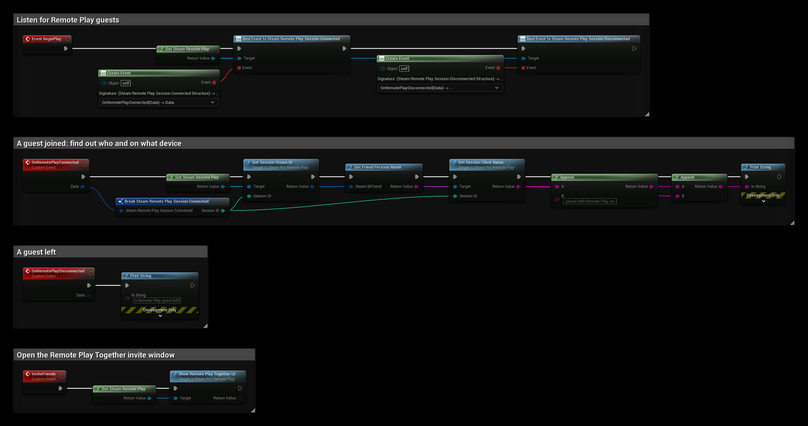

# Remote Play Together

Remote Play Together lets friends play a local multiplayer game with the player over the internet, without owning the game. The game runs on the host's computer, Steam streams it to the guests, and their input arrives as if they had controllers plugged in to the host's computer. The game does not need any networking for this.

SteamCore PRO tells you who joins through Remote Play and on what device, and can open the invite window.

## Prerequisites
- Remote Play Together allowed for your app. Check the Remote Play settings for your app on the [Steamworks partner site](https://partner.steamgames.com/apps/).
- A game with local multiplayer, such as split screen or shared screen.

## Guests Joining and Leaving
On **Get Steam Remote Play**:
- **Steam Remote Play Session Connected** fires when a guest joins, with a **Session ID**.
- **Steam Remote Play Session Disconnected** fires when a guest leaves.

Use the session ID with these nodes:

| Node | Returns |
| --- | --- |
| **Get Session Steam ID** | The guest's Steam ID. |
| **Get Session Client Name** | The name of the guest's device. |
| **Get Session Client Form Factor** | **Phone**, **Tablet**, **Computer** or **TV**. Use bigger text on a phone. |
| **BGet Session Client Resolution** | The guest's screen resolution. |

**Get Session Count** and **Get Session ID** list the guests who are connected now.

## Inviting Friends
**Show Remote Play Together UI** opens the Steam overlay window where the player invites friends. **BSend Remote Play Together Invite** invites one friend directly, by Steam ID.

## Example
- **BeginPlay** binds **Steam Remote Play Session Connected** and **Steam Remote Play Session Disconnected**.
- **OnRemotePlayConnected** prints the guest's name and device.
- **OnRemotePlayDisconnected** prints that a guest left.
- **InviteFriends** opens the Remote Play Together invite window.

