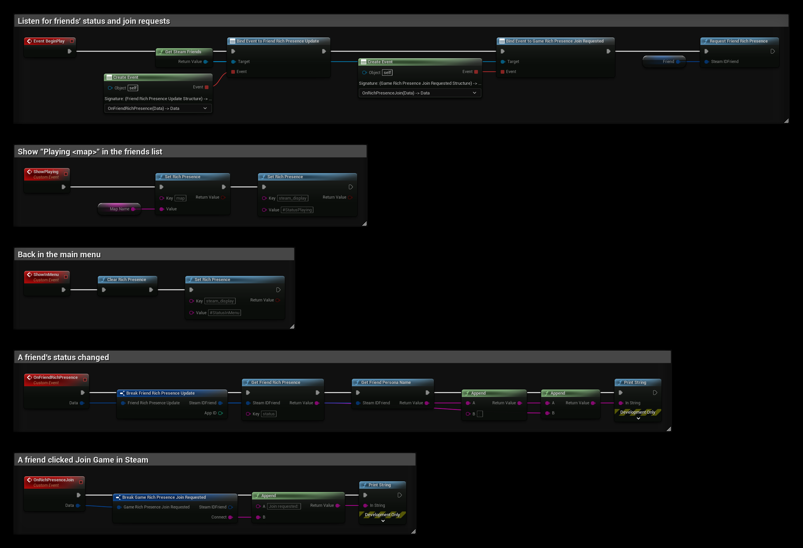

# Rich Presence

Rich Presence shows what a player is doing in your game, for example "In the main menu" or "Playing Dust (3/8)", in the Steam friends list. It also lets friends join a game from Steam.

## Prerequisites
- Your own Steam App ID, see [Using Your Own App ID](../getting_started/using-own-app-id.md). Rich Presence text is configured per app.

## How It Works
Rich Presence is a set of key/value pairs for the local player. Steam reads a few special keys:

| Key | Description |
| --- | --- |
| `steam_display` | A localization token, for example `#StatusPlaying`. Steam shows the localized text in the friends list. |
| `status` | Free text shown when a friend views your game info. |
| `connect` | The command line a friend's game receives when they join through Steam. |
| `steam_player_group` / `steam_player_group_size` | Groups players who play together, for example in the same party. |

Any other key can be used as a value inside the localized text.

## Step 1: Upload a Localization File
Go to **Community → Rich Presence** on the [Steamworks partner site](https://partner.steamgames.com/apps/) and upload a localization file:

```
"lang"
{
	"english"
	{
		"tokens"
		{
			"#StatusInMenu"   "In the main menu"
			"#StatusPlaying"  "Playing "
		}
	}
}
```

`` is replaced with the value of the `map` key.

## Step 2: Set Rich Presence
Call **Set Rich Presence** for each key:

| Key | Value |
| --- | --- |
| `map` | `Dust` |
| `steam_display` | `#StatusPlaying` |

Friends now see "Playing Dust". Call **Clear Rich Presence** to remove all keys, for example when the player returns to the main menu before you set new ones.

**Set Rich Presence** returns `false` if the key or value is too long or if too many keys are set.

## Reading a Friend's Rich Presence
1. Call **Request Friend Rich Presence** with the friend's Steam ID.
2. Use **Get Steam Friends** and bind **Friend Rich Presence Update**.
3. When it fires, call **Get Friend Rich Presence** with the friend's Steam ID and a key.

To list all keys, use **Get Friend Rich Presence Key Count** and **Get Friend Rich Presence Key by Index**.

## Joining Through Steam
When a friend clicks **Join Game** in Steam and your game is already running, **Game Rich Presence Join Requested** fires on **Get Steam Friends** with the friend's Steam ID and the **Connect** string.

:::note Sessions and the connect key
When you use SteamCore PRO sessions with **Allow Join via Presence** enabled, the plugin sets the `connect` key for you. Do not overwrite it with **Set Rich Presence**, or friends cannot join through Steam. See [Inviting Friends](../multiplayer/friends/inviting_friends.md).
:::

## Example
This Blueprint uses the localization tokens from Step 1. `MapName` is a **String** variable and `Friend` is a **Steam ID** variable:
- **BeginPlay** binds **Friend Rich Presence Update** and **Game Rich Presence Join Requested**, and requests the friend's Rich Presence.
- **OnFriendRichPresence** prints the friend's name and their `status` key when it changes.
- **OnRichPresenceJoin** prints the **Connect** string when a friend joins through Steam.
- **ShowPlaying** sets `map` and `steam_display`, so friends see "Playing Dust".
- **ShowInMenu** clears all keys and shows "In the main menu".



## Testing
Use Valve's [Rich Presence tester](https://steamcommunity.com/dev/testrichpresence) while the game is running to see the keys that are set for your account.
