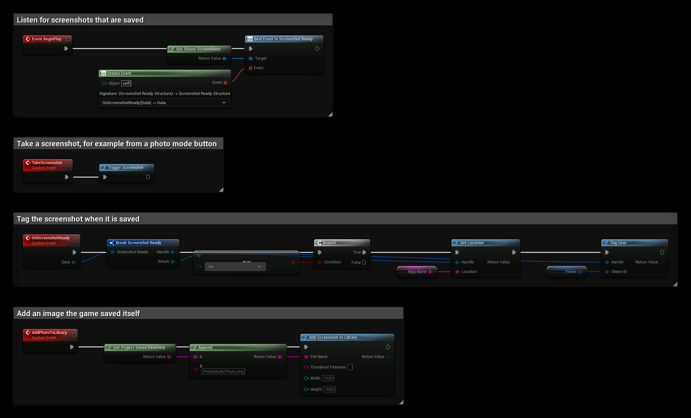

# Screenshots

Players can take screenshots with **F12** in any Steam game. SteamCore PRO lets your game take a screenshot itself, tag it with where it was taken and who is in it, and add images your game saved, for example from a photo mode, to the player's Steam screenshot library.

## Prerequisites
- The game started through Steam, or with Steam running. See [Testing Steam Functionality](../getting_started/testing_steam_functionality.md).

## Taking a Screenshot
**Trigger Screenshot** on **Get Steam Screenshots** takes a screenshot as if the player pressed the screenshot key. Use it for a photo mode button, or to capture a moment such as a win.

## Tagging Screenshots
When a screenshot is saved, **Screenshot Ready** fires on **Get Steam Screenshots** with its **Handle** and a **Result**. If **Result** is **OK**, you can tag it:

| Node | Description |
| --- | --- |
| **Set Location** | Text shown with the screenshot, for example the map's name. |
| **Tag User** | A player who is in the screenshot. Friends can find it on that player's profile. |
| **Tag Published File** | A Workshop item in the screenshot, for example a custom map. |

## Adding Your Own Images
**Add Screenshot to Library** adds a JPG, PNG or TGA file the game saved to the player's library. Pass the full path of the file and its **Width** and **Height** in pixels. Leave **Thumbnail Filename** empty and Steam makes the thumbnail. It returns a handle you can tag, and **Screenshot Ready** fires as well.

**Write Screenshot** does the same from raw RGB pixels instead of a file.

## Taking Over the Screenshot Key
By default Steam captures the screen when the player presses the screenshot key. Call **Hook Screenshots** with **Hook** checked to handle it yourself, for example to hide the HUD first. Steam then fires **Screenshot Requested** instead of taking the screenshot, and your game must save an image and call **Add Screenshot to Library** or **Write Screenshot**. **Is Screenshots Hooked** returns whether it is hooked.

## Example
`MapName` is a **String** variable and `Friend` is a **Steam ID** variable:
- **BeginPlay** binds **Screenshot Ready**.
- **TakeScreenshot** takes a screenshot.
- **OnScreenshotReady** sets the location to `MapName` and tags `Friend` when a screenshot is saved.
- **AddPhotoToLibrary** adds `Saved/PhotoMode/Photo.png`, an image the game saved itself, to the library.

