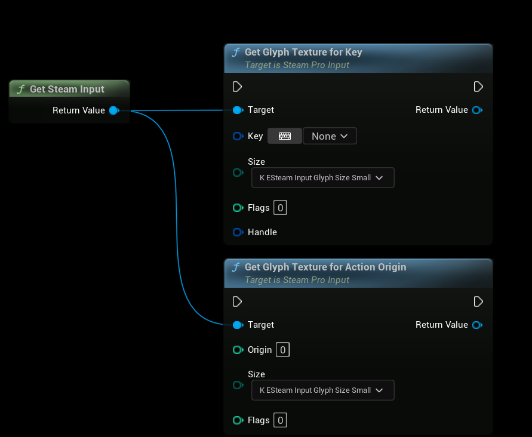
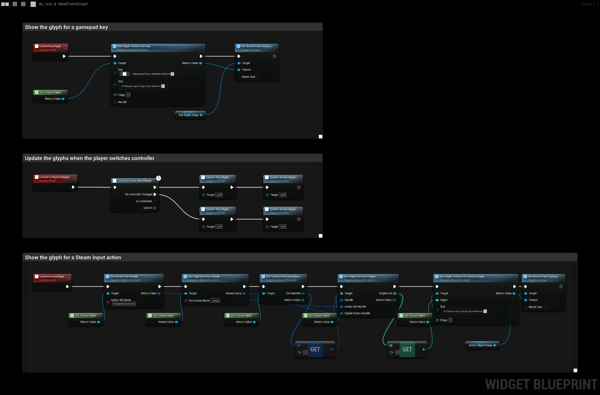
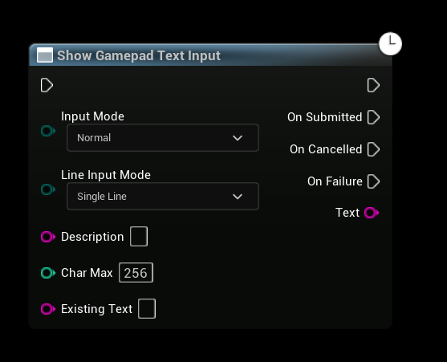
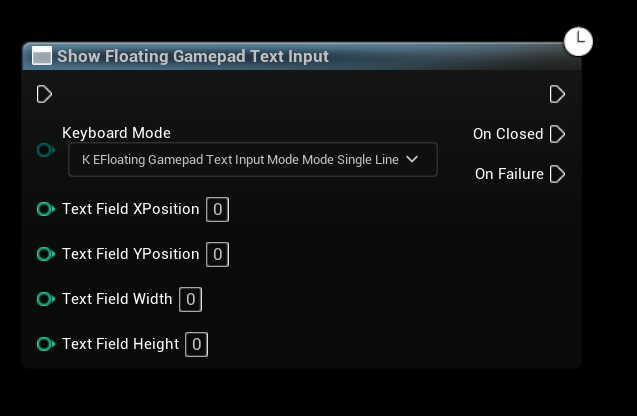

# Steam Deck and Steam Hardware

Steam Deck, Steam Machine and Steam Frame share the same requirements for controller support. To be **Verified**, a game must show glyphs that match the controller the player uses, and open an on-screen keyboard when the player needs to enter text. This page shows the nodes that cover both.

:::tip SteamCore PRO 1.1.12 and newer
The nodes and the widget on this page require SteamCore PRO 1.1.12 or newer.
:::

## Prerequisites
- Steam is running and the game is launched as a **Standalone Game** or a packaged build.
- For glyphs, call **Init** on **Get Steam Input** once, for example in your Game Instance.

## Glyphs for Unreal Gamepad Keys
Most games read input through Enhanced Input and Unreal's gamepad keys, such as **Gamepad Face Button Bottom**. Steam Input still knows which controller the player is using, so the plugin can show the right glyph for a key. The nodes are called on **Get Steam Input**:

| Node | Description |
| --- | --- |
| **Get Glyph Texture for Key** | Returns the glyph for a gamepad key as a texture, matching the player's controller. On a PlayStation controller, **Gamepad Face Button Bottom** returns the cross glyph. |
| **Get Action Origin for Key** | Returns the action origin for a gamepad key, if you want to use it with the other Steam Input nodes. |
| **Get Xbox Origin for Key** | Returns the Xbox button that matches a gamepad key. |

Leave **Handle** unconnected to use the first connected controller. If no controller is connected through Steam Input, **Get Glyph Texture for Key** returns the Xbox glyph.

To update the glyphs when the player switches controller, call **Listen for Controller Change** and refresh your UI in **On Controller Changed**.

### Example
This Widget Blueprint shows two glyphs in the Image widgets **KeyGlyphImage** and **ActionGlyphImage**:
- **UpdateKeyGlyph** shows the glyph for **Gamepad Face Button Bottom**.
- **UpdateActionGlyph** shows the glyph for the **Jump** action in the **InGameControls** action set, using the first connected controller.
- **ListenForGlyphChanges** updates both glyphs, and updates them again when the player switches controller. Call it from **Event Construct**.

## Entering Text
Steam has two on-screen keyboards. The nodes return **On Failure** when Steam can't show the keyboard, which happens when Steam isn't in Big Picture mode and the game isn't running on Steam hardware. Use your regular text input in that case.

### Text Input Dialog
**Show Gamepad Text Input** opens a full-screen dialog and returns the text when the player is done. It's in the **SteamCore|Utils|Async** category.

| Input | Description |
| --- | --- |
| **Input Mode** | **Normal**, or **Password** to hide the text. |
| **Line Input Mode** | **Single Line** or **Multiple Lines**. |
| **Description** | Tells the player what to enter, for example "Enter your name". |
| **Char Max** | The maximum number of characters. |
| **Existing Text** | Text the player can edit. |

**On Submitted** returns the text. **On Cancelled** is called when the player closes the dialog without submitting.

### Floating Keyboard
**Show Floating Gamepad Text Input** opens a keyboard over the game. The keys are sent to the game as regular keyboard input, so the player types into your own text box. Pass the position and size of the text box in pixels, relative to the game window, so the keyboard doesn't cover it. **On Closed** is called when the keyboard is closed.

### Steam Editable Text Box
The easiest option is the **Steam Editable Text Box** widget, found in the **SteamCore** category of the UMG palette. It works like a regular **Editable Text Box**, and opens the floating keyboard without covering the text box when it receives focus.

| Setting | Description |
| --- | --- |
| **Show Steam Keyboard** | Open the keyboard when the text box receives focus. Enabled by default. |
| **Close Steam Keyboard on Focus Lost** | Close the keyboard when the text box loses focus. Enabled by default. |

The keyboard layout follows the text box's **Keyboard Type**: **Number** shows a numeric keyboard and **Email** shows an email keyboard. Read-only text boxes don't open the keyboard.
