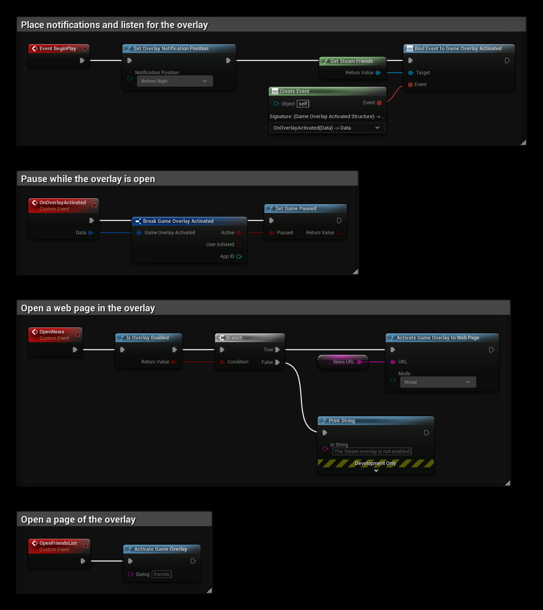

# Steam Overlay

The Steam overlay opens on top of the game with **Shift+Tab**. SteamCore PRO can open it at a page, show web pages and store pages in it, tell you when it opens and closes, and choose where Steam's notifications appear.

## Prerequisites
- The game started through Steam, or with Steam running. See [Testing Steam Functionality](../getting_started/testing_steam_functionality.md).
- The overlay enabled in the player's Steam settings.

## Checking the Overlay
**Is Overlay Enabled** on **Get Steam Utils** returns true if the overlay can be opened. The overlay can take a few seconds to start, so it returns false right after the game starts. Check it when the player opens a page, not only at start.

## Opening the Overlay
| Node | Opens |
| --- | --- |
| **Activate Game Overlay** | A page of the overlay. **Dialog** is one of `friends`, `community`, `players`, `settings`, `officialgamegroup`, `stats` or `achievements`. |
| **Activate Game Overlay to Web Page** | A web page. With **Mode** set to **Modal**, the page hides the other overlay windows, and closing it closes the overlay. With **Default**, it opens next to them and stays open. |
| **Activate Game Overlay to Store** | An app's store page, for example a DLC. **Flag** can also add it to the cart, see [DLC and Ownership](./dlc.md). |
| **Activate Game Overlay to User** | A page about a player, for example `steamid` for their profile or `friendadd` to add them as a friend. |
| **Activate Game Overlay Invite Dialog Connect String** | The dialog for inviting friends. A friend who accepts starts the game with the **Connect String**. |

## Reacting When the Overlay Opens
**Game Overlay Activated** fires on **Get Steam Friends** when the overlay opens and closes. **Active** is true while it is open, and **User Initiated** is true when the player opened it with **Shift+Tab**.

Use it to pause a single player game or to show the mouse cursor. Do not pause an online game, since the other players keep playing.

## Notification Position
**Set Overlay Notification Position** on **Get Steam Utils** chooses the corner where Steam shows notifications, for example when an achievement is unlocked or a friend comes online. **Set Overlay Notification Inset** moves them in from that corner, for example to keep them clear of your HUD.

## Example
`NewsURL` is a **String** variable with the page to open:
- **BeginPlay** shows notifications in the bottom right corner and binds **Game Overlay Activated**.
- **OnOverlayActivated** pauses the game while the overlay is open.
- **OpenNews** opens `NewsURL` in the overlay if the overlay is enabled.
- **OpenFriendsList** opens the friends list.

