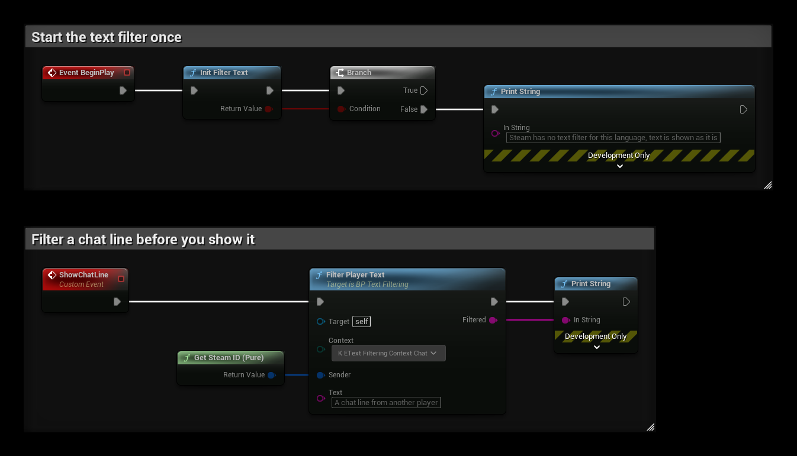
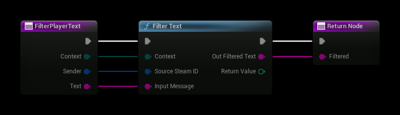

# Text Filtering

Steam can filter text that players write, such as chat lines and character names. It removes what the law requires in the player's region, and profanity and slurs if the player has chosen that in their Steam settings. Each player sees text filtered by their own settings.

Filter text from other players before you show it, and do the filtering on the client that shows the text, since it uses that player's settings.

## Step 1: Start the Filter
Call **Init Filter Text** on **Get Steam Utils** once, for example at start. It returns false if Steam has no filter for the language the player runs Steam in. **Filter Text** then returns the text unchanged.

## Step 2: Filter the Text
Call **Filter Text** with:

| Input | Description |
| --- | --- |
| **Context** | What the text is: **Chat** for chat from another player, **Name** for a character or item name, or **Game Content** for text where only legally required filtering is done. |
| **Source Steam ID** | The Steam ID of the player who wrote the text or chose the name. |
| **Input Message** | The text to filter. |

**Out Filtered Text** is the text with the filtered characters replaced, and **Return Value** is the number of characters that were filtered.

## Example
- **BeginPlay** starts the filter and prints a message if Steam has no filter for the player's language.
- **FilterPlayerText** is a function that filters text from a player in a given context. Call it wherever you show text from other players.
- **ShowChatLine** filters a chat line and prints it. It uses your own Steam ID only as a test; pass the Steam ID of the player who wrote the text.

The **FilterPlayerText** function:

