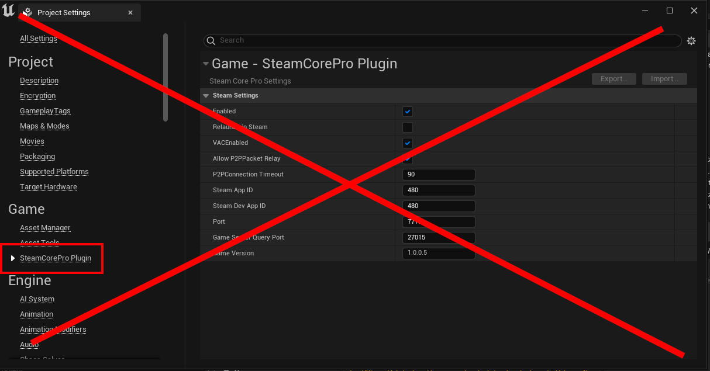

# Configuring the Plugin

:::info 📽️ Video Tutorial Available  
Watch the [Getting Started Video Tutorial](../videos/getting_started.mdx) for a walkthrough of the setup process.
:::

---

## Step 1: Configure `DefaultEngine.ini`

Edit your project's `DefaultEngine.ini` located at:
Project/Config/DefaultEngine.ini


> If you're setting up multiplayer features, make sure to also configure [SteamCoreSockets](../multiplayer/configuring_steamsockets.md).

:::note  
🔁 **Avoid Duplicate Entries**  
Before adding new configuration values, remove any old Steam-related settings from the file to prevent conflicts.
:::

---

## Recommended Settings

Use the following configuration for typical multiplayer projects:

```ini
[OnlineSubsystemSteamCore]
SteamDevAppId=480
SteamAppId=480
bVACEnabled=True
bEnabled=True
bUseSteamNetworking=True
bAllowP2PPacketRelay=True
bRelaunchInSteam=False
GameServerQueryPort=27015
GameVersion=1.0.0.0
bDisableSteamRelaunchInShipping=False

[OnlineSubsystem]
DefaultPlatformService=SteamCore

[/Script/Engine.GameEngine]
!NetDriverDefinitions=ClearArray
+NetDriverDefinitions=(DefName="GameNetDriver",DriverClassName="/Script/SteamCoreSockets.SteamCoreSocketsNetDriver",DriverClassNameFallback="/Script/OnlineSubsystemUtils.IpNetDriver")
```

## Minimal Required Settings
For basic usage (e.g. testing in development), this is the bare minimum configuration:

```ini
[OnlineSubsystemSteamCore]
bEnabled=True
SteamDevAppId=480
SteamAppId=480

[OnlineSubsystem]
DefaultPlatformService=SteamCore
```

## Available Settings
Below is a reference for all configurable options in the `[OnlineSubsystemSteamCore]` section of DefaultEngine.ini:
```ini
[OnlineSubsystemSteamCore]

// Enable or disable the SteamCore plugin
bEnabled=True

// Your app's Steam ID.
// SteamDevAppId is used in Development/Debug builds (and written to steam_appid.txt),
// SteamAppId is used in Shipping builds and by dedicated servers (required on servers).
SteamAppId=480
SteamDevAppId=480

// Use the SteamCoreSockets socket subsystem as the default socket subsystem
bUseSteamNetworking=True

// True: route traffic through the Steam relay network using Steam (P2P) addresses.
// False: connect directly via IP address (e.g. "open 1.2.3.4:7777").
// Can be overridden with the -SteamCoreSocketsRelays=true/false launch parameter.
bAllowP2PPacketRelay=True

// Development builds only: relaunch the game through the Steam client if it was not started via Steam
bRelaunchInSteam=False

// Shipping builds are always relaunched through Steam if not started via Steam.
// Set to True to disable this, e.g. to test Shipping builds locally.
// When True, steam_appid.txt is written next to the executable. (Requires SteamCore PRO 1.0.6.9 and later)
bDisableSteamRelaunchInShipping=False

// Dedicated servers: enable VAC (secure mode)
bVACEnabled=True

// Dedicated servers: Steam query port (can be overridden with -QueryPort=)
GameServerQueryPort=27015

// Dedicated servers: game version, must match the version set in the Steamworks partner site.
// Server advertising will fail if this is not set.
GameVersion=1.0.0.0

// Dedicated servers: product name and description sent to Steam (defaults to the SteamAppId)
GameServerProductName=MyGame
GameServerGameDescription=My Game

// Also initialize the Steam game server API on clients/listen servers (default: False)
bInitServerOnClient=False

// Windows Server targets only (build time): copy steamclient(64).dll, tier0_s(64).dll and
// vstdlib_s(64).dll from your local Steam installation into the packaged server.
// Files that are missing are skipped and a warning is printed in the build log.
bCopySteamDlls=True

// Online Identity: default token type for GetLinkedAccountAuthToken (App, Session or WebAPI[:identity])
DefaultLinkedAccountAuthTokenType=App

// Online Identity: remote service identity used for WebAPI tokens when none is specified
DefaultRemoteServiceIdentity=

// Override net.MinHandshakeVersion / net.CurrentHandshakeVersion
bOverrideMinHandshakeVersion=True
MinHandshakeVersion=0
bOverrideCurrentHandshakeVersion=True
CurrentHandshakeVersion=0
```

:::note Server Port
The game/listen port is **not** configured in the `[OnlineSubsystemSteamCore]` section. It is read from the engine's `[URL]` section (default `7777`) or from the `-Port=` [launch parameter](../parameters.md):

```ini
[URL]
Port=7777
```
:::

:::warning Handshake Version Overrides
If `bOverrideMinHandshakeVersion` / `bOverrideCurrentHandshakeVersion` are **not** present in your DefaultEngine.ini, they are treated as `True` and both `net.MinHandshakeVersion` and `net.CurrentHandshakeVersion` are set to `0` when the plugin starts.

If you want to keep Unreal Engine's default handshake versions, explicitly disable the overrides:

```ini
[OnlineSubsystemSteamCore]
bOverrideMinHandshakeVersion=False
bOverrideCurrentHandshakeVersion=False
```
:::

:::warning ⚠️ Project Settings Deprecated
Support for editing these settings via Project Settings has been removed in recent plugin versions. You must now configure everything through DefaultEngine.ini.
:::

