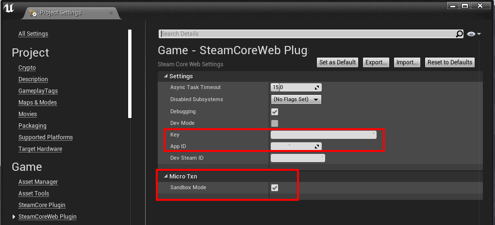
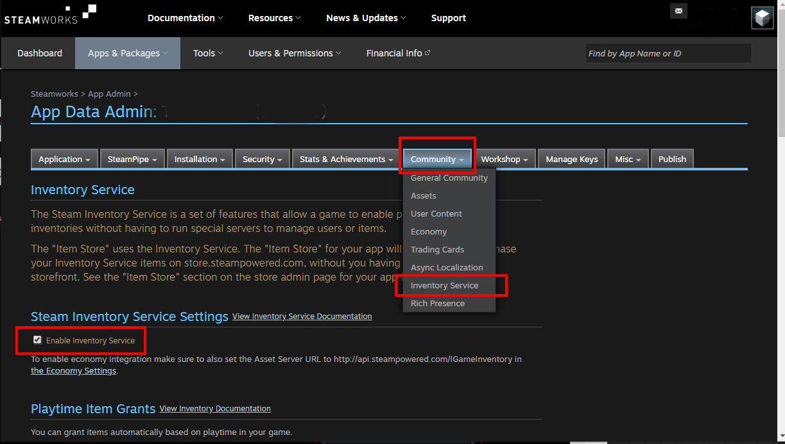
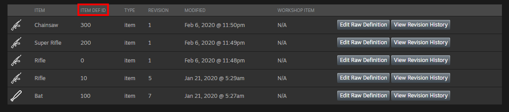
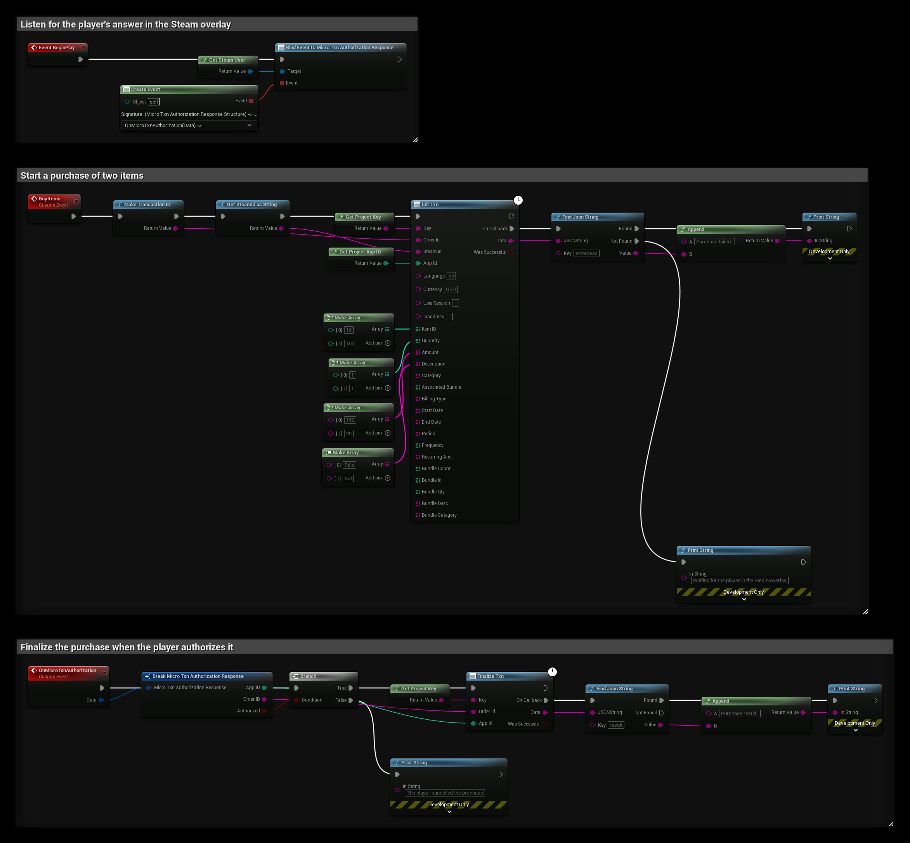

# Microtransactions

This guide explains how to implement microtransactions in your Unreal Engine game using the **SteamCore::Web** plugin, which is required to enable this functionality. Players can purchase in-game items, such as weapons or cosmetics, through Steam's payment system.

:::info
The **SteamCore::Web** plugin is a separate purchase required to use microtransaction functionality. Ensure you have acquired and installed it from [eelDev](https://www.fab.com/listings/7e0f0b69-0b35-4652-9cff-ef32a342e433) before proceeding.
:::

## Prerequisites
- [**SteamCore::Web**](https://www.fab.com/listings/7e0f0b69-0b35-4652-9cff-ef32a342e433) plugin installed in your Unreal Engine project.
- A valid **Steam App ID** and **Web API Key** from Valve (see [Steamworks Web API Documentation](https://partner.steamgames.com/doc/webapi_overview)).
- Steamworks Inventory Service enabled for your application.
- Configured item definitions in Steamworks for purchasable items.

## Configuring Plugin Settings
To enable microtransactions, configure the **SteamCore::Web** plugin settings in Unreal Engine.

1. Open **Project Settings** > **SteamCore::Web**.
2. Set your **Web API Key** obtained from Valve.
3. Enable **Sandbox Mode** for the MicroTXN Interface to test transactions without real payments.



## Setting Up Steamworks Inventory Service
Enable the Inventory Service in your Steamworks application settings to support microtransactions.

1. Navigate to **Steamworks Settings** > **Community** > **Inventory Service**.
2. Check **Enable Inventory Service**.



## Defining Purchasable Items
Define the items players can purchase in your game using the Steamworks Inventory Service schema. See the [Steamworks Inventory Schema Documentation](https://partner.steamgames.com/doc/features/inventory/schema) for details.

### Example Item Definition
Create a JSON schema for your items, specifying details like `itemdefid`, `type`, `price`, and more. Below is an example defining a "Drop Generator," "Hat Decoration," and "Red Hat."

```json
{
  "appid": 480,
  "items": [
    {
      "itemdefid": 10,
      "type": "playtimegenerator",
      "bundle": "100x100;101x50;102x25;103x2;110x20;111x20;120x5;121x3",
      "name": "Drop Generator",
      "name_color": "7D6D00",
      "background_color": "3C352E",
      "item_slot": "generator",
      "item_quality": 0,
      "icon_url": "http://cdn.beta.steampowered.com/apps/440/icons/c_fireaxe_pyro_xmas_large.fa878752e1aa09a721a03042a234063b6c929278.png",
      "icon_url_large": "http://cdn.beta.steampowered.com/apps/440/icons/c_fireaxe_pyro_xmas_large.fa878752e1aa09a721a03042a234063b6c929278.png",
      "tradable": false,
      "marketable": false
    },
    {
      "itemdefid": 100,
      "type": "item",
      "name": "Hat Decoration",
      "description": "Hat decoration description",
      "price": "1;USD99",
      "name_color": "7D6D00",
      "background_color": "3C352E",
      "item_slot": "decoration",
      "item_quality": 0,
      "icon_url": "http://cdn.beta.steampowered.com/apps/440/icons/c_fireaxe_pyro_xmas_large.fa878752e1aa09a721a03042a234063b6c929278.png",
      "icon_url_large": "http://cdn.beta.steampowered.com/apps/440/icons/c_fireaxe_pyro_xmas_large.fa878752e1aa09a721a03042a234063b6c929278.png",
      "tradable": true,
      "marketable": true
    },
    {
      "itemdefid": 200,
      "type": "item",
      "price": "1;VLV100",
      "name_english": "Red Hat",
      "name_german": "Roter Hut",
      "description_english": "Red Hat",
      "description_german": "Roter Hut",
      "store_tags": "hat;featured",
      "icon_url": "http://cdn.beta.steampowered.com/apps/440/icons/c_fireaxe_pyro_xmas_large.fa878752e1aa09a721a03042a234063b6c929278.png",
      "icon_url_large": "http://cdn.beta.steampowered.com/apps/440/icons/c_fireaxe_pyro_xmas_large.fa878752e1aa09a721a03042a234063b6c929278.png",
      "tradable": true,
      "marketable": true
    }
  ]
}
```



## Initiating a Transaction
To start a purchase, use the **Init Txn** node to create a transaction for specific items. The [example](#example) at the bottom of this page starts a purchase of a "Rifle" (ItemDefID: 10) and a "Bat" (ItemDefID: 100).

:::note
The example uses the item definitions from the Example Project, not the JSON schema above. Use the `itemdefid` values from **your own** schema, and only items that have a `price` set can be purchased (for example, the `playtimegenerator` item in the schema above cannot be bought).
:::

### Steps
1. Add the **Init Txn** node to your game logic (e.g., in a UI Blueprint triggered by a "Buy" button).
2. Pass a new order ID from **Make Transaction ID**, the player's Steam ID from **Get SteamId as String**, and your key and App ID from **Get Project Key** and **Get Project App ID**.
3. For each item, add its `ItemDefID`, quantity, amount (in cents) and description to the arrays, in the same order.
4. When the node calls back, look for `errordesc` in **Data** with **Find Json String**. If it is not there, Steam shows the purchase to the player in the Steam Overlay.

### Demo Video
Watch a short demo of purchasing a "Bat" item. For a complete example, download the Example Project from [eelDev](https://eeldev.com).

import ReactPlayer from 'react-player'

<ReactPlayer url='/img/legacy/2020-02-19076f72082d7b1de554fc1f665a2144.mp4' controls={true}/>

## Finalizing a Transaction
After the player confirms the purchase via the Steam Overlay, finalize the transaction to complete the process and grant the items to the player. Use the **Finalize Txn** node provided by **SteamCore::Web**, or implement custom logic.

### Steps
1. Use **Get Steam User** and bind **Micro Txn Authorization Response** to detect when the player authorizes or denies the transaction.
2. If **Authorized** is true, call **Finalize Txn** with the **Order ID** and **App ID** from the event.
3. Grant the purchased items to the player (e.g., update inventory or unlock content).
4. Handle denial cases by informing the player (e.g., via a UI message).

## Example
This Blueprint uses nodes from both SteamCore PRO and **SteamCore::Web**:
- **BeginPlay** binds **Micro Txn Authorization Response**.
- **BuyItems** starts a purchase of a Rifle and a Bat with **Init Txn**, and prints `errordesc` if Steam returns an error.
- **OnMicroTxnAuthorization** finalizes the purchase with **Finalize Txn** if the player authorized it and prints the `result`. If not, it prints that the player cancelled.



## Notes
- **Sandbox Mode**: Always enable Sandbox Mode during testing to avoid real charges. Disable it for production.
- **Security**: Use the **GetReliableUserInfo** endpoint to verify the Steam user’s reliability before initiating transactions to prevent fraud.
- **Error Handling**: Implement logic to handle transaction failures, such as insufficient funds or Steam Overlay issues, and provide clear feedback to players.
- **Localization**: Support multiple languages in item definitions (e.g., `name_english`, `name_german`) for a global audience.
- **Testing**: Test transactions thoroughly in Sandbox Mode to ensure proper integration with Steam’s Inventory Service.