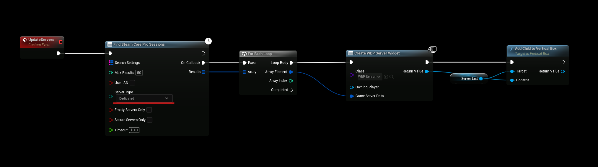
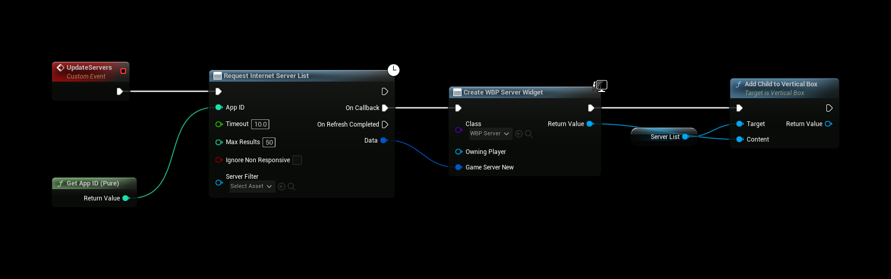

# Finding the Server
:::tip TIP
This Example has a Video Tutorial that you can find here: [Related Video](../../videos/dedicated-server-ue5.mdx)
:::

There are two ways to find dedicated servers. If you are not sure which one to use, try both and see what works best for your game.

| Method | Use it when |
| --- | --- |
| **Find SteamCore PRO Sessions** | You want the simplest setup and join servers with the regular session nodes. |
| **Request Internet Server List** | You are building a server browser and need details such as ping, map, player count or tags. |

## Find SteamCore PRO Sessions
This method is simpler to use but exposes less server information. The results can be joined directly, see [Connecting to a Dedicated Server](./connecting.md).

## Request Internet Server List

### Inputs
| Input | Description |
| --- | --- |
| **App ID** | Your Steam App ID. The default is **480**, so change it to your own App ID. |
| **Timeout** | Seconds before the search stops. |
| **Max Results** | The search stops when this many servers have been found. |
| **Ignore Non Responsive** | Skip servers that are listed by Steam but do not answer. |
| **Server Filter** | Optional filters, see [Filtering Servers](./filtering_dedicated_servers.md). |

### Outputs
- **On Callback** fires once for **each** server that is found. It returns a **Game Server Item** with fields such as **Server Name**, **Map Name**, **Game Tags**, **Ping**, **Players**, **Max Players**, **Password** and the server address.
- **On Refresh Completed** fires once when the search is finished. Use it to hide a loading indicator or show a "no servers found" message.

**On Refresh Completed** always fires, also when the search times out, fails or is cancelled. (Requires SteamCore PRO 1.1.10 and later.)

### Other Server Lists
The same inputs and outputs are used by **Request LAN Server List**, **Request Friends Server List**, **Request Favorites Server List**, **Request History Server List** and **Request Spectator Server List**.

### Refreshing and Cancelling
Only one server list request runs at a time. Starting a new request cancels the previous one, and the previous node fires **On Refresh Completed**. To stop a search yourself, for example when the player closes the server browser, call **Cancel Server List Queries**.

## Getting More Information About a Server
| Node | Description |
| --- | --- |
| **Ping Server** | Queries a single server by IP and query port. **On Callback** returns the **Game Server Item** and whether the server answered. |
| **Server Rules** | Returns the server's key/value rules. |

Starting a new **Ping Server** or **Server Rules** request cancels the previous one of the same kind. A cancelled or timed out request fires **On Callback** with **bWasSuccessful** set to false. Use **Cancel Ping Queries** and **Cancel Server Rules Queries** to stop them yourself.

## Troubleshooting
- **No servers are found:** check that **App ID** is your own App ID, that the server is running with the same App ID, and that the query port (**27015** by default) is open. See [Introduction](./introduction.md) for the server requirements.
- **The server is missing from the list:** the game version in Steamworks must match the server's version, see [Steamworks Settings](./steamworks.md).
