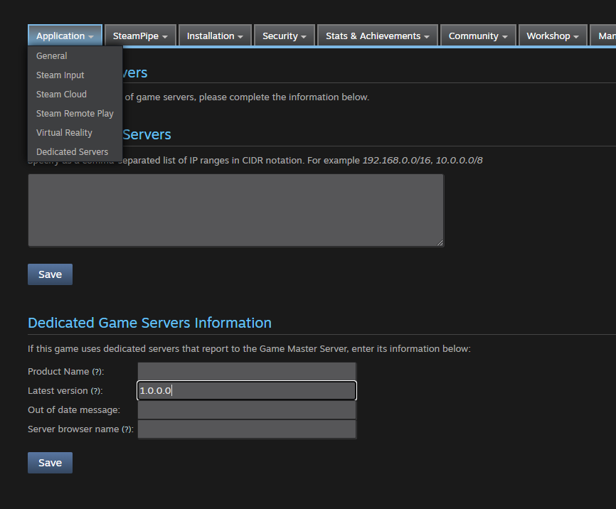

# Steamworks Settings
:::tip TIP
This Example has a Video Tutorial that you can find here: [Related Video](../../videos/dedicated-server-ue5.mdx)
:::

Go to the Steamworks settings for your application and change the "Dedicated Game Servers Information" to include the latest version for your game, see the example below.

- [Link to Steamworks](https://partner.steamgames.com/home)
- The page is located at `https://partner.steamgames.com/apps/dedicatedservers/<YourAppId>`

The version must match the `GameVersion` set in the `[OnlineSubsystemSteamCore]` section of your DefaultEngine.ini, see [Configuring the Plugin](../../getting_started/configuring-plugin.md). Server advertising fails if the versions do not match.