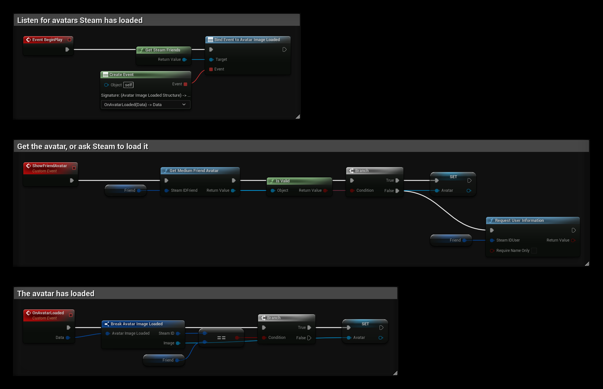

# Friend Avatars

:::info Video Tutorial is available
[Video Tutorial](../../videos/friends_list_avatars.mdx)
:::

Steam avatars are returned as a **Texture 2D** that you can use in a UMG **Image** widget, for example with **Set Brush from Texture**.

## Getting an Avatar
Call one of the avatar nodes with the player's Steam ID:

| Node | Size |
| --- | --- |
| **Get Small Friend Avatar** | 32×32 |
| **Get Medium Friend Avatar** | 64×64 |
| **Get Large Friend Avatar** | 128×128 |

To get the local player's own avatar, pass the result of **Get Steam ID**.

## When the Avatar Is Not Loaded Yet
Steam downloads avatars in the background. If the avatar is not available yet, the node returns an **invalid** texture. Handle this case:

1. Check the returned texture with **Is Valid**.
2. If it is not valid, use **Get Steam Friends** and bind the **Avatar Image Loaded** event.
3. When the event fires, compare **Data → Steam ID** with the player you asked for and use **Data → Image**.

## Players Who Are Not Your Friends
Steam only knows about your friends and players you share a lobby, game server or leaderboard with. For other players, call **Request User Information** first. When Steam has the information, the avatar nodes work as described above.

## Example
`Friend` is a **Steam ID** variable and `Avatar` is a **Texture 2D** variable that an Image widget can use:
- **BeginPlay** binds **Avatar Image Loaded**.
- **ShowFriendAvatar** gets the medium avatar. If it is not valid yet, it calls **Request User Information** so Steam loads it.
- **OnAvatarLoaded** sets `Avatar` when the loaded avatar belongs to `Friend`.

See also [Friend List](./friends_list.md).
