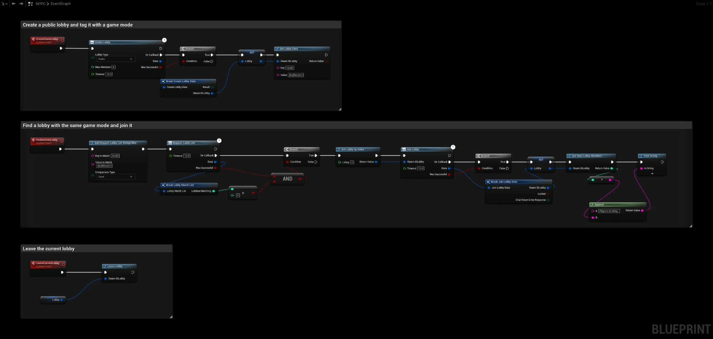

# Lobbies

This guide explains how to create, find and join Steam lobbies with the **SteamCore|Matchmaking** nodes. A lobby is a group of players that can share data and chat before a game starts. To move the players from a lobby into a game, see [Lobby to Game Session](lobby_to_game_session.md).

## Prerequisites
- Steam is running and the game is launched as a **Standalone Game** or a packaged build. Steam is not available in Play In Editor, see [Testing Steam Functionality](../getting_started/testing_steam_functionality.md).
- To find each other's lobbies, all players must use the same Steam App ID.

## Creating a Lobby
Call **Create Lobby** with a **Lobby Type** and **Max Members**. When **On Callback** fires with **Was Successful**, the lobby's Steam ID is in **Data**. You are the owner of the lobby and are already inside it.

| Lobby Type | Who can find and join it |
| --- | --- |
| **Private** | Only players you invite. |
| **Friends Only** | Your friends and players you invite. |
| **Public** | Everyone, through **Request Lobby List**. |
| **Invisible** | Returned by **Request Lobby List**, but not shown to friends. |

## Lobby Data
The owner can attach key/value strings to the lobby with **Set Lobby Data**, for example the game mode or map. Every player can read them with **Get Lobby Data**. The data is used both to show information about a lobby and to filter the search.

Each member can also set their own data with **Set Lobby Member Data**, for example a selected character. Read it with **Get Lobby Member Data**.

## Finding Lobbies
1. Add filters with the **Add Request Lobby List ...** nodes, for example **Add Request Lobby List String Filter** to match a lobby data key.
2. Call **Request Lobby List**. When **On Callback** fires, **Lobbies Matching** in **Data** is the number of lobbies found.
3. Get each lobby's Steam ID with **Get Lobby By Index**.

:::note
Filters are cleared on each call to **Request Lobby List**, so add them again before every search. The results only include lobbies that are not full, that are **Public** or **Invisible**, and that are joinable. By default only lobbies in the same or nearby regions are returned; use **Add Request Lobby List Distance Filter** to change that.
:::

## Joining and Leaving
- **Join Lobby** joins a lobby by its Steam ID. Check **Was Successful** in **On Callback**.
- **Get Num Lobby Members** and **Get Lobby Member By Index** list the players in the lobby. **Get Lobby Owner** returns the owner.
- **Leave Lobby** leaves the lobby. When the owner leaves, Steam makes another member the owner.

## Lobby Events
Use **Get Steam Matchmaking** and bind the events you need:

| Event | Fired when |
| --- | --- |
| **Lobby Enter** | You have entered a lobby. |
| **Lobby Chat Update** | A player joined, left or was disconnected. |
| **Lobby Data Update** | Lobby data or member data changed. |
| **Lobby Chat Msg** | A chat message was sent in the lobby. |
| **Lobby Invite** | A friend invited you to a lobby. |
| **Lobby Game Created** | The owner set the game server with **Set Lobby Game Server**. |

## Example
This Blueprint uses a variable **Lobby** of type **Steam ID**:
- **CreateGameLobby** creates a public lobby for 4 players, stores it in **Lobby** and sets the lobby data `mode` to `deathmatch`.
- **FindAndJoinLobby** searches for lobbies where `mode` is `deathmatch`, joins the first one, stores it in **Lobby** and prints the number of players in it.
- **LeaveCurrentLobby** leaves the lobby stored in **Lobby**.

## Troubleshooting
- **Request Lobby List finds nothing:** make sure the lobby is **Public**, not full, and that both players use the same App ID. With App ID 480, many other games' lobbies exist, so always use a filter such as a game mode key.
- **No lobbies from other regions:** add **Add Request Lobby List Distance Filter** before **Request Lobby List**.
- Enable [Additional Logging](../additional/additional_logging.md) to see the plugin's output.
