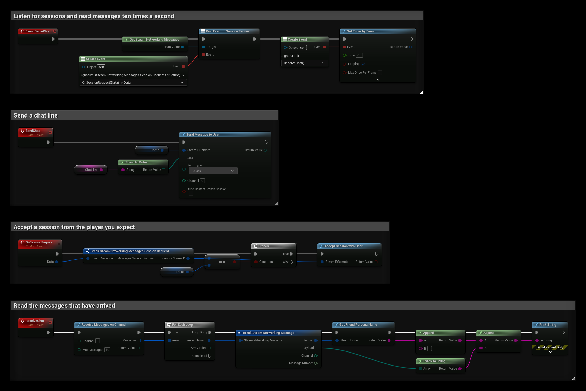

# P2P Messages

Steam Networking Messages sends data directly between players, without an Unreal Engine network connection. Use it for things outside regular replication, for example chat, invites or small game data between players in a lobby. Steam handles NAT traversal and relays the traffic when a direct connection isn't possible.

The nodes are called on **Get Steam Networking Messages** and are in the **SteamCore|NetworkingMessages** category.

:::note
This is Valve's replacement for the old **SteamCore|Networking** P2P functions (**Send P2P Packet** and **Read P2P Packet**). Use Networking Messages for new code.
:::

## Prerequisites
- Steam is running and the game is launched as a **Standalone Game** or a packaged build.
- Both players are logged in to Steam. To test, you need two Steam accounts on two computers.

## Sending a Message
Call **Send Message To User** with:

| Input | Description |
| --- | --- |
| **Steam ID Remote** | The player to send to. |
| **Data** | The message as a byte array. |
| **Send Type** | **Reliable** messages arrive in order and are resent if lost. **Unreliable** messages can be lost but have less overhead. The **No Nagle** and **No Delay** variants send immediately instead of waiting to batch messages. |
| **Channel** | A number the receiver reads from. Use different channels to keep different kinds of messages apart. |
| **Auto Restart Broken Session** | Starts a new session automatically if the previous one failed. |

It returns **OK** when the message was queued. The first message to a player opens a session, which can take a moment.

## Accepting Sessions
When another player sends you their first message, the **Session Request** delegate is broadcast with their Steam ID. Call **Accept Session With User** to accept. Messages from that player are not delivered until you accept or send a message to them yourself.

Only accept sessions from players you expect, for example members of your lobby.

## Receiving Messages
Messages are not pushed to you. Call **Receive Messages On Channel** regularly, for example from **Event Tick** or a timer, with the channel and the maximum number of messages to read. **Messages** contains, for each message:

| Field | Description |
| --- | --- |
| **Sender** | The Steam ID of the player who sent it. |
| **Payload** | The message data. |
| **Channel** | The channel it was sent on. |
| **Message Number** | An increasing number per session. |

## Closing Sessions
Sessions time out after a few minutes without traffic. To end one right away, call **Close Session With User**, or **Close Channel With User** to close a single channel. The session closes when all its channels are closed.

## Session Status
**Get Session Connection Info** returns the state of the session with a player: **Connecting**, **Finding Route**, **Connected**, **Closed By Peer** or **Problem Detected Locally**. **Info** contains the ping, connection quality, whether the traffic is relayed, and the reason the session ended.

If a session can't be established or breaks, the **Session Failed** delegate is broadcast with the same information.

## Example
A simple chat between two players. `Friend` is a **Steam ID** variable, for example a lobby member, and `ChatText` is a **String** variable:
- **BeginPlay** binds **Session Request** and starts a looping timer that calls **ReceiveChat** ten times a second.
- **SendChat** turns `ChatText` into bytes with **String to Bytes** and sends it on channel 0.
- **OnSessionRequest** accepts the session only if it comes from `Friend`.
- **ReceiveChat** reads up to 10 messages on channel 0 and prints each sender's name and text, using **Bytes to String**.

## Dedicated Servers
On a dedicated server, the nodes use the game server's own Steam identity automatically.
