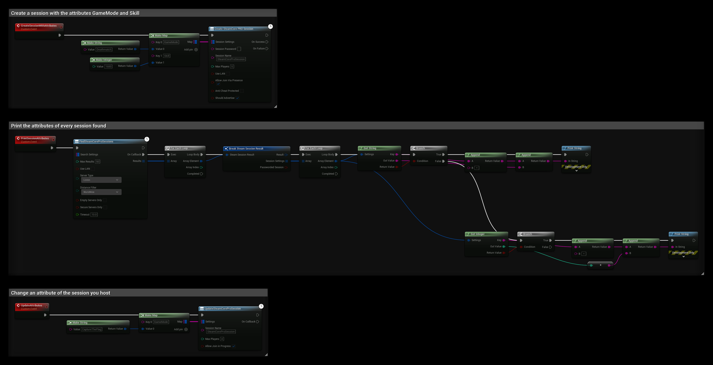

# Custom Session Attributes
You can create sessions with **custom attributes**, for example a game mode or a skill level. Use them to filter your search results, see [Finding Sessions](./finding_multiplayer_games.md#search-filtering-options), or to show more about each session in your server list.

:::info Video Tutorial is available
[Video Tutorial](../../videos/multiplayer/setting-up-steam-multiplayer.mdx)
:::

## Creating a Session with Attributes
Connect a **Make Map** node to **Session Settings** on **Create SteamCore PRO Session**. Each key is the attribute's name, and each value is made with **Make String** or **Make Integer**.

## Reading Attributes
Each search result has a **Session Settings** array. Loop through it and call **Get String** or **Get Integer** on each setting. They return `true` when the setting has that type, and output its **Key** and value.

## Updating Attributes
The host can change the attributes with **Update SteamCore PRO Session**, using a **Make Map** in the same way.

## Example
- **CreateSessionWithAttributes** creates a session with `GameMode` = `Deathmatch` and `Skill` = `1600`.
- **PrintSessionAttributes** finds sessions and prints every string and integer attribute of each one, for example `GameMode = Deathmatch`.
- **UpdateAttributes** changes `GameMode` to `CaptureTheFlag`.

