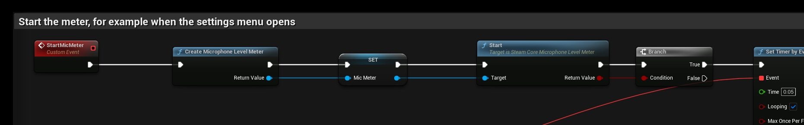
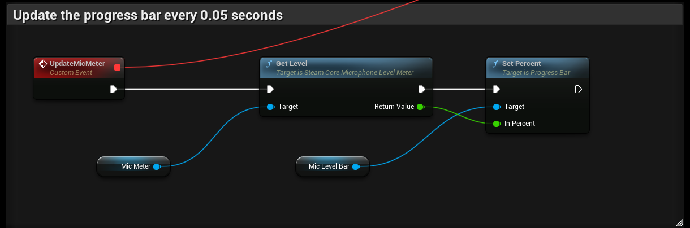
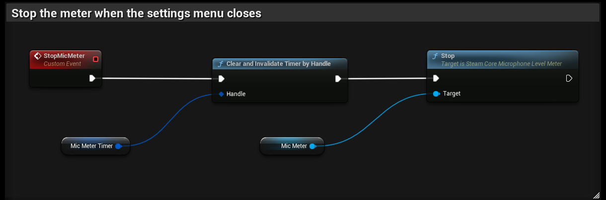
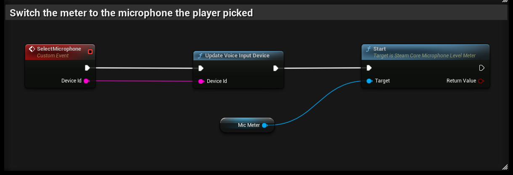

# Microphone Level Meter
:::warning NOTE
Requires SteamCore PRO 1.2.0 and newer
:::

The Microphone Level Meter shows how loud the player's microphone is, for example as a bar in your audio settings menu, so the player can check that the selected microphone works.

The meter opens its own preview capture of the microphone. It doesn't read from the voice chat stream and doesn't affect voice transmission. It works outside a multiplayer session, for example in the main menu, and while push-to-talk isn't held.

:::tip NOTE
The meter uses the microphone saved with **Update Voice Input Device**, see [Select Microphone Input](./select_microphone.md). If no microphone is saved, it uses the default input device.
:::

## Prerequisites
- Voice has to be enabled in your **DefaultEngine.ini**, see [Voice Chat](./voice_chat.md). If it isn't, **Start** returns false.
```cpp
[Voice]
bEnabled=true
```

## Showing the Microphone Level
1. Call **Create Microphone Level Meter** and store the result in a variable, for example in your settings widget. The meter stops when the object is destroyed, so keep the reference for as long as the meter is used.
2. Call **Start**. It returns true if the microphone was opened.
3. Call **Get Level** on a timer, for example every `0.05` seconds, and set the **Percent** of a **Progress Bar** to the returned value.
4. Call **Stop** when the settings menu closes to release the microphone.







## Changing Microphone
When the player selects another microphone, call **Update Voice Input Device** and then call **Start** again. **Start** stops the current capture and opens the new device.



Voice chat itself picks up the new device when you join or create a session, see [Select Microphone Input](./select_microphone.md).

## Nodes
| Node | Description |
| --- | --- |
| **Create Microphone Level Meter** | Creates a new meter. |
| **Start** | Opens the microphone saved with **Update Voice Input Device**, or the default device if none is saved. Returns false if the microphone couldn't be opened. Calling it while the meter is running restarts it. |
| **Get Level** | Returns the level from `0` (silent) to `1` (loudest). Returns `0` if the meter isn't started. |
| **Get Peak Amplitude** | Returns the loudest sample, from `0` to `1`, from the last **Get Level** call that received audio. It isn't scaled to decibels. |
| **Is Active** | Returns true while the meter is capturing. |
| **Get Device Name** | Returns the name of the device the meter opened. It is empty when the default device is used. |
| **Stop** | Releases the microphone and resets the level to `0`. |

## Settings
| Variable | Default | Description |
| --- | --- | --- |
| **Min Decibels** | `-60` | The quietest level shown. Sound at this level or below gives `0`, and `0` dB gives `1`. Must be `-1` or lower. |
| **Fall Speed** | `1.5` | How fast the level drops when the sound gets quieter, in level per second. With `1.5`, the level drops from `1` to `0` in about 0.7 seconds. |

The level rises at once when the sound gets louder, and falls smoothly by **Fall Speed** when it gets quieter. Because of this, **Get Level** should be called regularly, for example on a timer or on **Tick**.
