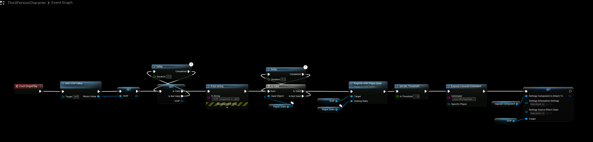
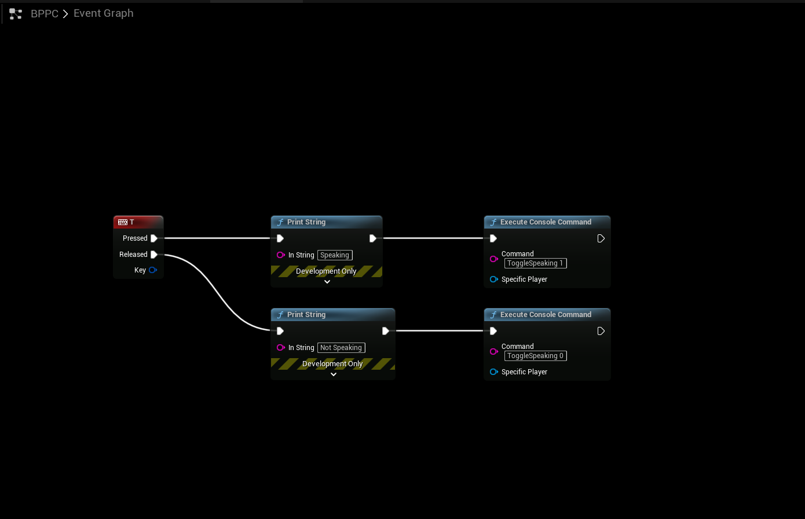
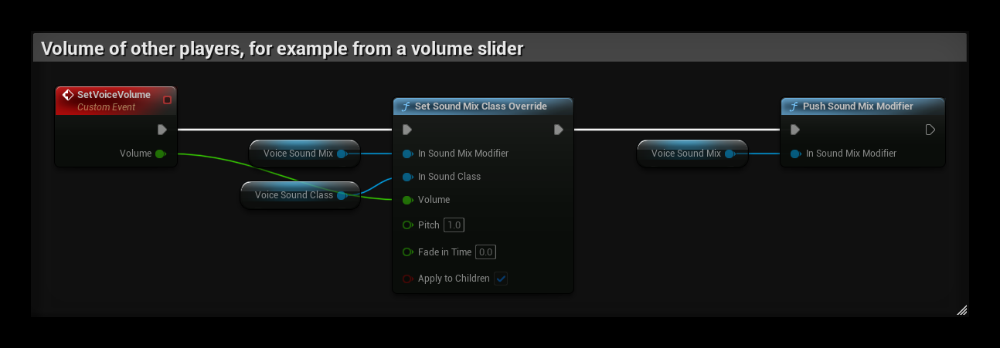
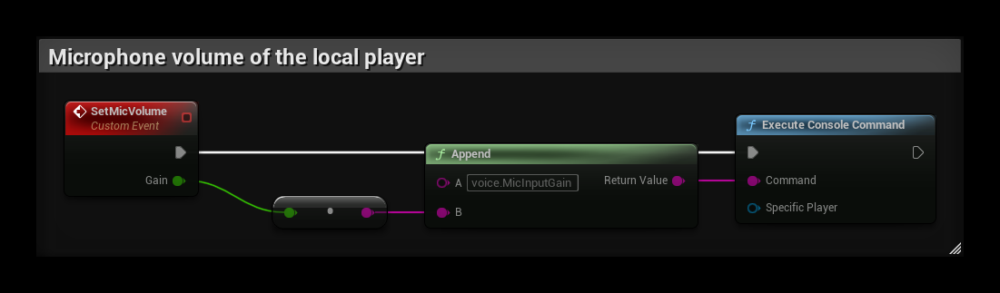

# Voice Chat
## SteamCore Session
- Setting up Voice Chat for SteamCore Online Multiplayer Sessions 

### DefaultEngine.ini
- First edit your **DefaultEngine.ini** configuration file and make sure it has these values configured.
```cpp
[Voice]
bEnabled=true

[OnlineSubsystem]
DefaultPlatformService=SteamCore
bHasVoiceEnabled=true

[/Script/Engine.GameSession]
bRequiresPushToTalk=true
```

### Complete DefaultEngine.ini Example
- Below is a configuration example that includes all SteamCore settings (including Voice Chat configuration)
```
[Core.Log]
LogOnlineVoice=Verbose
LogSteamCorePro=Verbose
LogSteamCoreSockets=Verbose
LogSteamCoreShared=Verbose

[OnlineSubsystemSteamCore]
SteamDevAppId=480
SteamAppId=480
bVACEnabled=True
bEnabled=True
bUseSteamNetworking=True
bAllowP2PPacketRelay=True
bRelaunchInSteam=False
GameServerQueryPort=27015
GameVersion=1.0.0.5

[Voice]
bEnabled=true

[OnlineSubsystem]
DefaultPlatformService=SteamCore
bHasVoiceEnabled=true

[/Script/Engine.GameSession]
bRequiresPushToTalk=true
```

## Blueprint Setup
- This example is going to utilize the Character and PlayerController blueprints to setup and handle VOIP

### Character Blueprint
- Add the nodes as shown below, make sure to check validity of the VOIP component and the PlayerState as these are not always initialized and present at BeginPlay.



### PlayerController Blueprint
- The PlayerController is going to control the Push to Talk input.



## Voice Volume

### Volume of Other Players
Voice playback uses the **VOIP Sound Class** from the project settings.

1. Create a **Sound Class**, for example `SC_Voice`, and set its **Volume**, for example to `2.0`.
2. Select it in **Project Settings → Engine → Audio → VOIP Sound Class**.

To change the volume at runtime, for example from a volume slider in your settings menu, create a **Sound Mix**. Call **Set Sound Mix Class Override** with the Sound Mix, `SC_Voice` and the new **Volume**, then call **Push Sound Mix Modifier** with the Sound Mix.

In the example below, `VoiceSoundMix` and `VoiceSoundClass` are variables set to your Sound Mix and `SC_Voice`. **Fade In Time** is `0` so the new volume applies at once.



### Microphone Volume
The console variable `voice.MicInputGain` controls how loud the local player's microphone is for other players. The default is `1.0`. It applies to Windows.

```
[SystemSettings]
voice.MicInputGain=2.0
```

You can also set it at runtime with **Execute Console Command**, for example `voice.MicInputGain 2.0`.



If quiet speech is cut off, lower `voice.MicNoiseGateThreshold`. Speech below this threshold is not sent.

:::note
High values on either setting can cause distortion. Increase them in small steps.
:::

## Testing Voice
- [Testing Steam Functionality](../../getting_started/testing_steam_functionality.md)